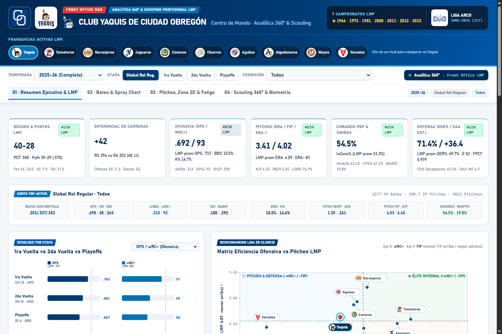
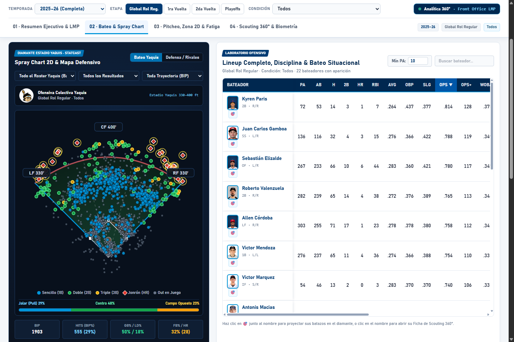
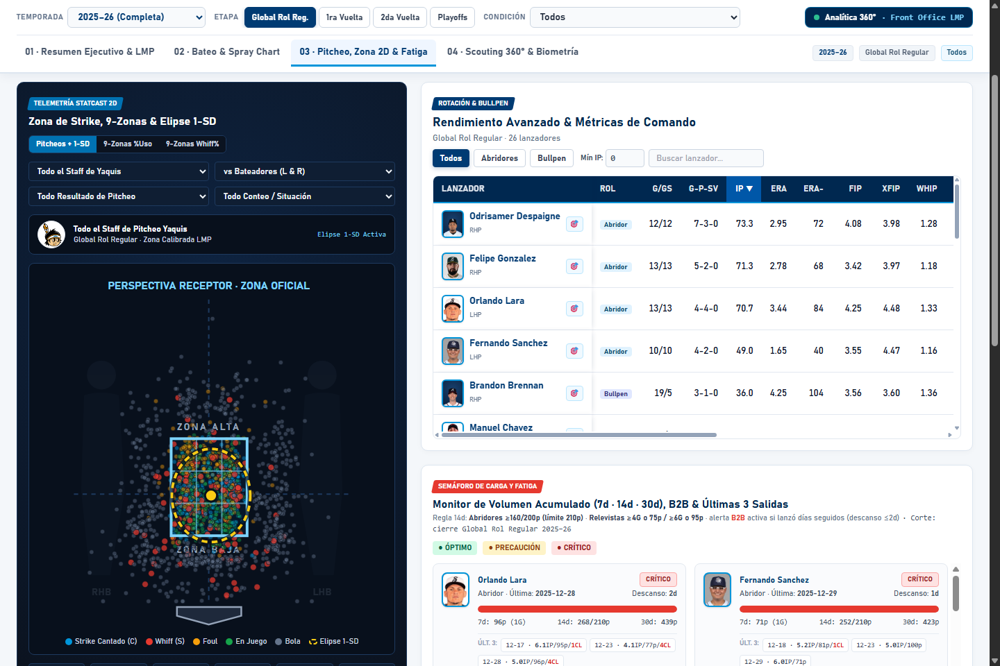
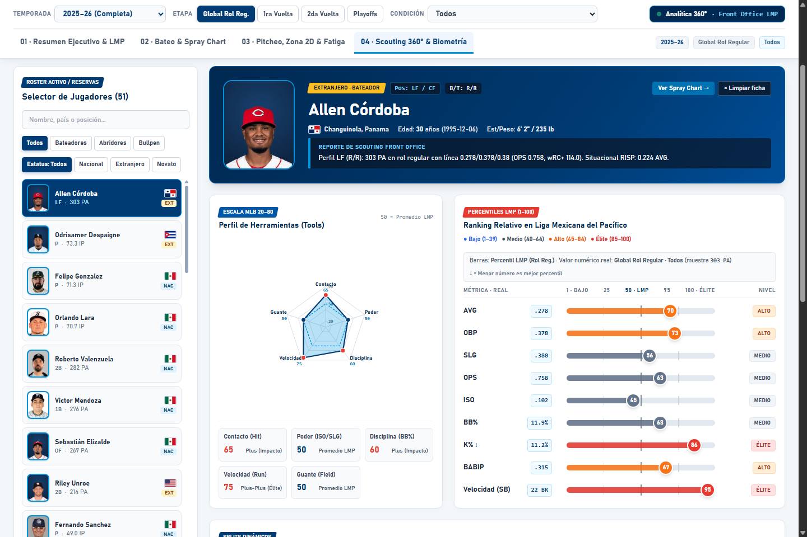
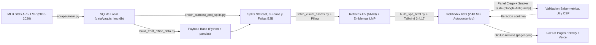

<div align="center">
  
  <h1>Dashboard Front Office — Club Yaquis de Ciudad Obregón (LMP)</h1>
  <p>
    <strong>Plataforma estática autocontenida de Analítica 360°, Sabermetría, Telemetría Statcast 2D y Scouting Profesional 20–80</strong><br />
    Cobertura histórica de <strong>21 temporadas (2006–2026)</strong> en la <em>Liga ARCO Mexicana del Pacífico (LMP)</em>
  </p>

  <p>
    
    
    
    
    
    
    
  </p>

  <p>
    <a href="https://gzzalejandro.github.io/yaquis_obregon_analisis_de_datos_LMP/">
      
    </a>
  </p>
  <p>
    <strong>Demo interactiva en vivo:</strong>
    <a href="https://gzzalejandro.github.io/yaquis_obregon_analisis_de_datos_LMP/">https://gzzalejandro.github.io/yaquis_obregon_analisis_de_datos_LMP/</a>
  </p>
</div>

---

## Vista Previa del Dashboard

<table>
  <tr>
    <td width="50%">
      <strong>01 · Resumen Ejecutivo &amp; Benchmarking LMP</strong><br />
      <a href="https://gzzalejandro.github.io/yaquis_obregon_analisis_de_datos_LMP/">
        
      </a>
    </td>
    <td width="50%">
      <strong>02 · Bateo &amp; Spray Chart 2D (Estadio Yaquis)</strong><br />
      <a href="https://gzzalejandro.github.io/yaquis_obregon_analisis_de_datos_LMP/">
        
      </a>
    </td>
  </tr>
  <tr>
    <td width="50%">
      <strong>03 · Pitcheo, Zona de Strike 2D &amp; Fatiga B2B</strong><br />
      <a href="https://gzzalejandro.github.io/yaquis_obregon_analisis_de_datos_LMP/">
        
      </a>
    </td>
    <td width="50%">
      <strong>04 · Scouting 360° (Escala 20–80 &amp; Percentiles)</strong><br />
      <a href="https://gzzalejandro.github.io/yaquis_obregon_analisis_de_datos_LMP/">
        
      </a>
    </td>
  </tr>
</table>

---

## Propósito del Proyecto — Experimento con Google Antigravity en Analítica de Béisbol

Este repositorio nace como un **proyecto de portafolio e investigación aplicada** para evaluar hasta qué punto las herramientas agénticas de **Google Antigravity** permiten diseñar, implementar, auditar y endurecer de extremo a extremo una plataforma de análisis de datos enfocada al béisbol profesional —con estándares visuales y sabermétricos comparables a herramientas de **Front Office** (*Baseball Savant*, *TruMedia* y *FanGraphs*).

En lugar de construir un prototipo aislado, todo el ciclo de ingeniería y control de calidad se orquestó mediante **colaboración multi-agente y *skills* especializadas** dentro de Google Antigravity:

| Fase en Google Antigravity | Rol Agéntico / *Skill* Aplicada | Responsabilidad en el Proyecto |
| :--- | :--- | :--- |
| **1. Exploración & Auditoría de Datos** | Subagente de Investigación + Auditor LMP/MLB API | Exploración del ecosistema sabermétrico Python y validación de cobertura, consistencia histórica (`2006–2026`) e integridad referencial en SQLite. |
| **2. Arquitectura Analítica & Diseño UI** | Subagente Líder de Analítica Deportiva (`kpi-dashboard-design`, `frontend-design`, `build-ui`, `data-storytelling`, `grafana-dashboards`, `generative_ui`) | Modelado sabermétrico (`wRC+`, `FIP`, `OPS+`, `DER%`, percentiles, escala `20–80`) y diseño de gráficas SVG nativas estilo Statcast sin librerías pesadas de terceros. |
| **3. Panel Ciego de Revisión (5 Roles)** | 5 subagentes revisores **sin contexto previo del código** | Auditoría independiente del dashboard compilado desde perspectivas reales de una organización de béisbol: |
| ↳ *Director Deportivo (Front Office)* | Revisión ejecutiva y de toma de decisiones | Lectura inmediata de KPIs, balance del roster, benchmarking entre los 10 clubes y cortes `1ra Vuelta / 2da Vuelta / Playoffs`. |
| ↳ *Coach de Campo & Dugout* | Revisión táctica en tiempo real | Comprensión directa de la zona de strike 2D, mapas `9-Zonas`, splits situacionales (`RISP`, `2Out`, `LHB`/`RHB`) y alertas de fatiga `B2B`. |
| ↳ *Diseñador Deportivo UI/UX* | Revisión estética, cromática y responsiva | Jerarquía visual, identidad Club Yaquis (`#003B73` / `#0095DA`), retratos `4:5`, legibilidad de ejes Statcast y tablas móviles. |
| ↳ *Scout Profesional de Avanzada* | Revisión de evaluación de talento | Coherencia entre grados `20–80`, percentiles LMP (`1–100`), supresión de porcentajes sintéticos en muestras `0 PA/0 IP` y comparador `A vs B`. |
| ↳ *Auditor QA & Seguridad Web* | Verificación automatizada e integridad | Pruebas DOM/JS en Node.js, eliminación de CDNs externos, política `CSP` estricta, limpieza de rutas locales y preparación segura para GitHub. |

---

## Arquitectura del Pipeline



---

## Módulos del Dashboard (4 Vistas Interactivas)

### 01 · Resumen Ejecutivo & Benchmarking LMP
- **Tarjetas KPI ejecutivas** con posición exacta en liga (`#1`–`#10`), diferencia de carreras y pulso por etapa (**1ra Vuelta**, **2da Vuelta** y **Playoffs**).
- **Frente a frente interactivo** contra cualquiera de los otros **9 clubes de la LMP** (con unificación histórica para franquicias como *Mayos / Nayarit* en la tabla y comparativos).
- **Matriz Ofensiva vs Pitcheo** (`wRC+` vs `FIP`), **tabla ordenable de 10 clubes**, balance estructural del roster (*Nacional / Extranjero / Novato* y *Abridores / Bullpen*) y **serie histórica de 21 temporadas (2006–2026)**.

### 02 · Bateo & Spray Chart 2D
- **Diamante 2D interactivo** calibrado a las dimensiones del Estadio Yaquis (modo *Ofensiva Yaquis* y *Defensiva vs Rivales*), con selector de resultados y barra direccional **Pull / Center / Oppo**.
- **Eficiencia defensiva espacial por zona** (`DER%`, `OAA est.`, `CS%` de receptores) y tabla de splits situacionales (`RISP`, `2Out RISP`, `HighLev OPS`).
- **Bloque comparativo estilo MLB Statcast:** gráficas SVG de **Dispersión**, **Boxplot + Swarm** y **Ranking `wRC+`** con tooltips interactivos por jugador.

### 03 · Pitcheo, Zona 2D & Fatiga
- **Visor de Zona de Strike 2D** en perspectiva del receptor con **elipse de comando `1-SD`** y mapas de calor **`9-Zonas`** (`%Uso` y `Whiff%`).
- **Filtros tácticos combinables:** lateralidad del bateador (`Todos`, `LHB`, `RHB`) y conteo situacional (`Todos`, `0-0`, `2K`, `RISP`).
- **Semáforo de Fatiga y Carga de Trabajo:** volumen acumulado a `7d / 14d / 30d`, alertas **`B2B`** (*back-to-back* condicionadas a recencia `<= 2 días`), porcentaje de carga sobre umbral (`95p` / `200p` y salidas `4G` / `6G`) y registro de las **últimas 3 salidas**.

### 04 · Scouting 360° & Biometría
- **Selector profesional de roster** con **retratos `4:5` (`176×220`)** procesados con composición de estudio sobre gradiente Yaquis (`64/68` fotografías reales resueltas y silueta vectorial con monograma `CO` para casos sin foto).
- **Radar poligonal Escala MLB `20–80`** combinado con **barras de percentiles Savant LMP (`1–100`)**, protegiendo muestras con `0 PA / 0 IP` para evitar percentiles sintéticos.
- **Comparador Cara a Cara (`A vs B`)** con soporte completo tanto para **Bateadores** como para **Pitchers** (incluyendo subfiltro *Abridores / Bullpen*), deltas estadísticos automáticos y splits por etapa y condición (*Local / Visita / RISP / vs LHP / vs RHP*).

---

## Stack Tecnológico y Herramientas Utilizadas

| Capa | Tecnologías y Herramientas | Propósito Principal |
| :--- | :--- | :--- |
| **Entorno Agéntico & QA** | **Google Antigravity** (Multi-Agent Subagents, Skills `build-ui` / `frontend-design` / `kpi-dashboard-design` / `data-storytelling` / `grafana-dashboards` / `generative_ui`) | Orquestación de desarrollo, auditoría sabermétrica, panel ciego de 5 roles y validación integral. |
| **Ingesta & Almacenamiento** | **Python 3.11+**, `requests`, `SQLAlchemy`, **SQLite**, `PyYAML` | Scraper resiliente contra la MLB Stats API (`sportId=17`, `leagueId=132`) y modelo relacional normalizado por juego, aparición y pitcheo. |
| **Analítica & Activos** | `pandas`, `numpy`, `Pillow` (`176×220`), **Marimo** (`01_auditoria_marimo.py`, `02_eda_yaquis_marimo.py`) | Cálculo de métricas sabermétricas, agregación Statcast, notebooks reactivos de auditoría/EDA y recorte estandarizado de retratos `4:5`. |
| **Frontend & Visualización** | **HTML5**, **Vanilla JavaScript (ES6+)**, **SVG Nativo**, **Tailwind CSS v3.4.17** (compilado estáticamente) | SPA interactiva sin frameworks pesados ni librerías de gráficas externas; tipografía tabular y componentes de alta densidad. |
| **Seguridad & Despliegue** | **Node.js** (smoke tests DOM + verificación sintáctica), `CSP` estricto, **GitHub Actions** (`pages.yml`) | Cero peticiones salientes en producción, sanitización anti-fugas locales y publicación directa en la web. |

---

## Seguridad, Privacidad y Rendimiento

- **SPA 100% autocontenida (`web/index.html`, `2.48 MB`):** incluye el CSS de Tailwind precompilado, los datos sabermétricos embebidos y los activos gráficos en Base64/SVG, funcionando incluso **sin conexión a Internet** (`file://` o servidor estático).
- **Aislamiento total (`Content-Security-Policy` estricta):**
  - `default-src 'none'; img-src 'self' data:; style-src 'unsafe-inline'; script-src 'unsafe-inline'; font-src 'self' data:; connect-src 'none'; object-src 'none'; base-uri 'none'; form-action 'none';`
  - `<meta name="referrer" content="no-referrer" />`
- **Cero telemetría externa:** `0` scripts CDN, `0` cookies, `0` rastreadores, `0` llamadas de red en tiempo de ejecución y `0` rutas locales o credenciales en el repositorio.

---

## Estructura del Repositorio

```text
yaquis_obregon_analisis_de_datos_LMP/
├── .gitattributes                      # Marca web/index.html, JSON y CSS compilado como linguist-generated
├── .github/workflows/
│   └── pages.yml                       # Despliegue automático a GitHub Pages desde ./web
├── config.yaml                         # Parámetros API LMP, equipos y temporadas (2006–2026)
├── requirements.txt                    # Dependencias Python verificadas
├── LICENSE                             # Licencia MIT (código fuente)
├── docs/
│   ├── ANALYSIS_AND_UI_BLUEPRINT.md    # Diseño analítico y blueprint de arquitectura
│   └── assets/                         # 4 capturas preview en alta resolución del dashboard
│       ├── 01_resumen_ejecutivo.png
│       ├── 02_spray_chart.png
│       ├── 03_zona_2d_fatiga.png
│       └── 04_scouting_360.png
├── notebooks/
│   ├── 01_auditoria_marimo.py          # Auditoría reactiva de integridad en SQLite
│   └── 02_eda_yaquis_marimo.py         # Análisis exploratorio 1ra Vuelta / 2da Vuelta / Playoffs
├── scraper/
│   ├── main.py                         # Pipeline CLI de extracción LMP -> SQLite
│   ├── parser.py                       # Parsers de boxscores, play-by-play y pitcheos
│   └── sources/mlb_stats_api.py        # Cliente HTTP con rate-limiting
├── storage/
│   └── db.py                           # Esquema SQLAlchemy (Games, Players, PA, Pitches, Boxscores)
├── scripts/
│   ├── audit_db.py                     # Validación de cobertura e integridad de la BD
│   ├── clean_db.py                     # Limpieza de registros auxiliares/exhibición
│   ├── enrich_and_fix_risp.py          # Enriquecimiento situacional RISP
│   ├── build_front_office_data.py      # Agregación sabermétrica -> front_office_payload.json
│   ├── enrich_statcast_and_splits.py   # Telemetría 2D, 9-Zonas, splits y fatiga/B2B
│   ├── fetch_visual_assets.py          # Descarga, recorte 4:5 (176×220) y caché de emblemas/fotos
│   └── build_spa_html.py               # Compilador final del HTML autocontenido (web/index.html)
└── web/
    ├── index.html                      # Producto final listo para GitHub Pages (2.48 MB)
    ├── assets/                         # tailwind.min.css + og_preview.png + emblemas + 64 retratos cacheados
    └── data/front_office_payload.json  # Payload analítico estructurado (2.17 MB)
```

> **Nota sobre la base de datos SQLite:** `data/yaquis_lmp.db` (`~323 MB`) y los cachés locales (`__pycache__/`, `notebooks/__marimo__/`) están excluidos mediante `.gitignore` para mantener el repositorio ligero y compatible con los límites de GitHub. El archivo `web/index.html` ya contiene todo el payload necesario para ejecutarse inmediatamente.

---

## Reproducción y Ejecución Local

### 1. Abrir el Dashboard directamente (sin instalar dependencias)
Puedes abrir `web/index.html` directamente en tu navegador, o servir la carpeta `web/` con Python:

```bash
python -m http.server -d web 8080
```

Luego visita `http://localhost:8080`.

### 2. Recompilar el HTML desde el payload existente
```bash
python -m venv .venv
# Windows: .venv\Scripts\activate  |  Linux/macOS: source .venv/bin/activate
pip install -r requirements.txt

python scripts/build_spa_html.py
```

### 3. Reconstruir el pipeline completo desde la API (`data/yaquis_lmp.db`)
```bash
# 1) Descargar temporadas piloto (2025-2026) o todo el rango histórico (--all: 2006-2026)
python -m scraper.main --all

# 2) Generar el payload analítico base y enriquecer splits Statcast / fatiga B2B
python scripts/build_front_office_data.py
python scripts/enrich_statcast_and_splits.py

# 3) Actualizar activos visuales y retratos 4:5 (opcional --refresh-players)
python scripts/fetch_visual_assets.py

# 4) Compilar web/index.html
python scripts/build_spa_html.py
```

### 4. Explorar los notebooks interactivos con Marimo
```bash
marimo edit notebooks/01_auditoria_marimo.py
marimo edit notebooks/02_eda_yaquis_marimo.py
```

---

## Despliegue en la Web

- **GitHub Pages (en vivo y automático):** Disponible en [https://gzzalejandro.github.io/yaquis_obregon_analisis_de_datos_LMP/](https://gzzalejandro.github.io/yaquis_obregon_analisis_de_datos_LMP/). Este repositorio incluye `.github/workflows/pages.yml` (`Settings → Pages → Build and deployment → Source: GitHub Actions`), publicando la carpeta `web/` automáticamente en cada push a `main`.
- **Netlify / Vercel / Cloudflare Pages:** Establece `web` como directorio de publicación estático (*Publish directory: `web`*); no requiere comando de build en la nube.

---

## Créditos, Fuentes y Aviso Legal

### Créditos Principales
- **Autoría e Ingeniería del Proyecto:** **Oscar Gonzalez** — diseño conceptual, dirección analítica, curaduría sabermétrica y validación del producto final.
- **Plataforma Agéntica de Desarrollo:** **Google Antigravity** — utilizado como entorno central de experimentación multi-agente para generar, refinar visualmente, someter a revisión ciega multi-rol y auditar la seguridad del panel.
- **Datos Deportivos y Telemetría:** **Liga ARCO Mexicana del Pacífico (LMP)** y **MLB Stats API** (endpoints públicos de *Winter Leagues*, `sportId=17`, `leagueId=132`).
- **Identidad Visual y Retratos de Jugadores:** **Club Yaquis de Ciudad Obregón** (paleta institucional y monograma `CO`), catálogos públicos de **MLB / MiLB** y **Wikimedia Commons** (fotografía de respaldo).
- **Ecosistema Open Source:** **Tailwind CSS** (licencia MIT), **Python**, **pandas**, **NumPy**, **SQLAlchemy**, **Pillow** y **Marimo**.

### Aviso Legal / Non-Commercial Disclaimer
Este es un **proyecto independiente y sin fines de lucro**, desarrollado con objetivos estrictamente **educativos, experimentales y de portafolio profesional**. No está afiliado, patrocinado ni respaldado oficialmente por la **Liga ARCO Mexicana del Pacífico (LMP)**, **Major League Baseball (MLB)** ni el **Club de Béisbol Yaquis de Ciudad Obregón**. Todas las marcas registradas, nombres de clubes, estadísticas y fotografías pertenecen a sus respectivos propietarios. El código fuente propio de este repositorio se distribuye bajo la licencia [MIT](LICENSE).
